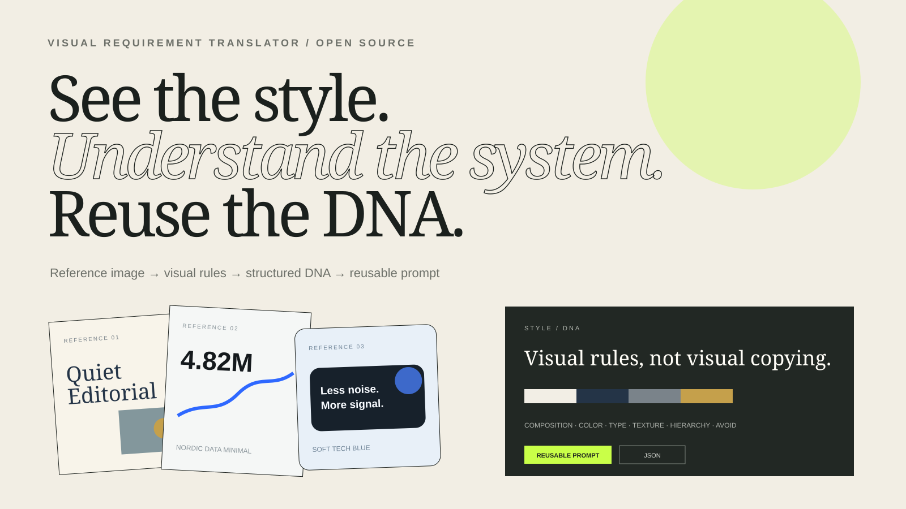
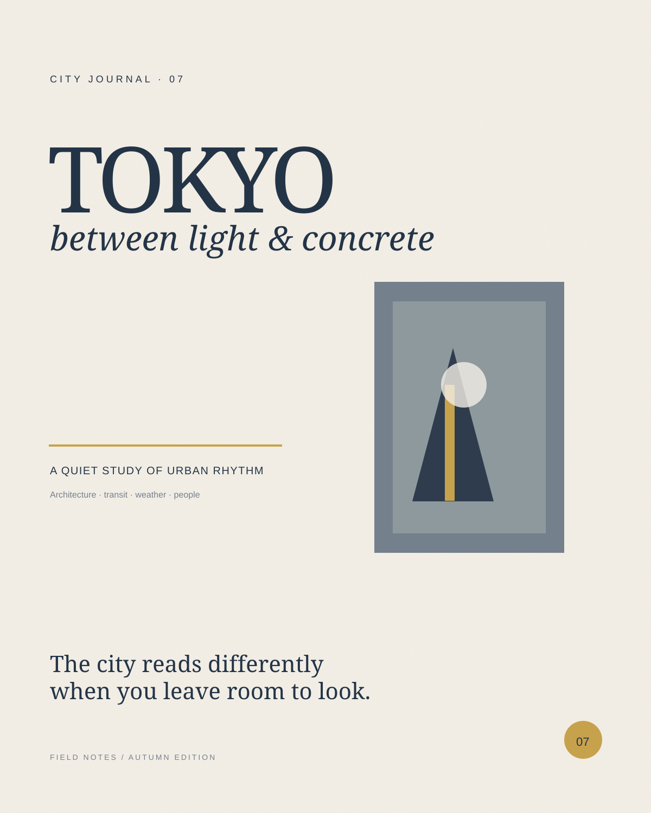
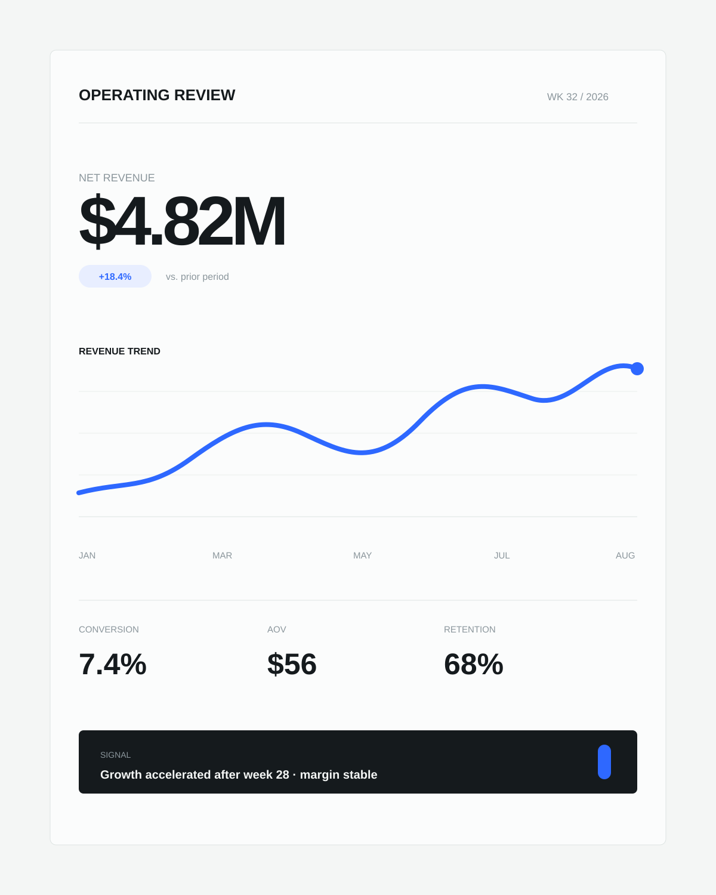
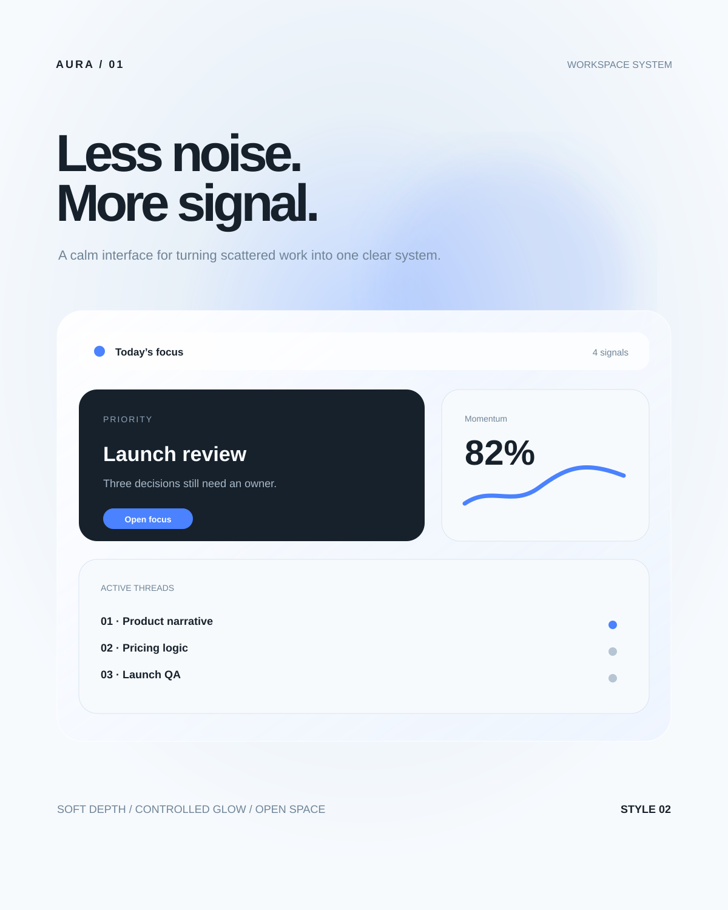
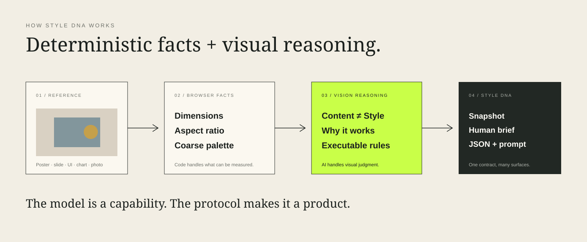
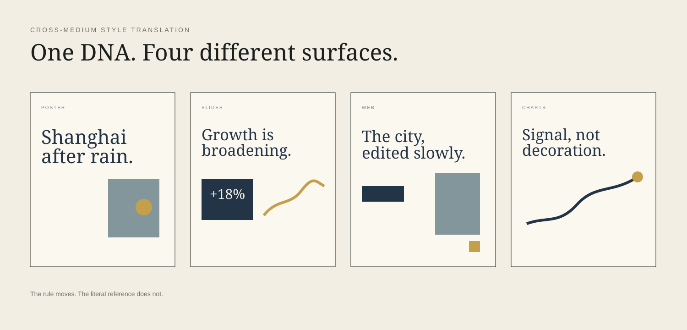

<div align="center">
  

# Style DNA

**See the style. Understand the system. Reuse the DNA.**

Turn visual inspiration into reusable design language.

[Quick start](#quick-start) · [Product notes](docs/PRODUCT.md) · [Architecture](docs/ARCHITECTURE.md) · [Protocol](docs/STYLE_DNA_PROTOCOL.md)

<p>
  
  
  
  
</p>
</div>

<p align="center">
  
</p>

<p align="center">
  
</p>

## The problem

People are often good at **judging** visual quality and bad at **describing** it.

> “I like this feeling.”  
> “Can you make it look more like this?”  
> “The spacing, colors and type feel right — I just cannot explain why.”

Those are real preferences, but weak production instructions.

Style DNA turns a reference into a reusable visual specification:

```text
REFERENCE IMAGE
      ↓
CONTENT ≠ STYLE
      ↓
COMPOSITION · COLOR · TYPE · TEXTURE · HIERARCHY · MOOD · AVOID
      ↓
STYLE DNA
      ↓
HUMAN BRIEF · JSON · AI-READY PROMPT
```

The point is **not** to copy a reference image. The point is to extract the rules that make the reference feel the way it does.

---

## Visual Atlas — no API key required

The repository ships with three intentionally different examples, so the product can be explored before any model configuration.

<table>
  <tr>
    <td width="33%"></td>
    <td width="33%"></td>
    <td width="33%"></td>
  </tr>
  <tr>
    <td><b>Quiet Editorial</b><br/><sub>Warm print restraint</sub></td>
    <td><b>Nordic Data Minimal</b><br/><sub>Analytical, not sterile</sub></td>
    <td><b>Soft Tech Blue</b><br/><sub>Depth without visual noise</sub></td>
  </tr>
</table>

Each sample opens the **same analysis contract** while producing a different Style DNA. That is the product test: the protocol should generalize across posters, dashboards and interfaces instead of memorizing one aesthetic.

---

## What Style DNA returns

### 1. Style Snapshot

A five-second read:

```text
Editorial · Warm neutral · Asymmetric · High whitespace · Restrained accent
```

### 2. Executable visual rules

Instead of stopping at `minimal` or `premium`, the output explains things like:

- asymmetric editorial grid;
- strong left alignment;
- high outer whitespace;
- low-saturation warm-neutral palette;
- one restrained accent role;
- oversized serif / compact sans hierarchy;
- subtle matte paper texture;
- soft image contrast;
- low decorative density.

### 3. Why It Works

Mood is tied to visible evidence. For example, “calm” is not just a label — it may be explained by high whitespace, soft contrast and low saturation.

### 4. Negative Style DNA

The analyzer also generates what **not** to add:

```text
Avoid neon colors
Avoid heavy gradients
Avoid plastic 3D
Avoid over-sharpening
Avoid oversized glossy cards
```

### 5. Portable output

- human-readable visual brief;
- structured JSON;
- AI-ready prompt that explicitly preserves new content and transfers style only.

---

## How it works

<p align="center">
  
</p>

The product deliberately splits measurement from judgment:

**Browser code** handles deterministic facts:

- original dimensions;
- aspect ratio;
- coarse dominant palette;
- upload validation;
- resize/compression before model input.

**Vision reasoning** handles abstract visual relationships:

- media type;
- content/style separation;
- composition and spatial rhythm;
- typography personality;
- texture and image treatment;
- hierarchy and mood;
- negative constraints;
- explanation of why the design works.

> **The model is a capability. The protocol + schema + deterministic preprocessing are the product layer.**

---

## Content ≠ Style

If a reference contains Tokyo Tower, a taxi and a yellow title, Style DNA does **not** treat those literal objects as reusable visual rules.

| Content | Style |
| --- | --- |
| Tokyo Tower | asymmetric composition |
| taxi | restrained accent color |
| literal title | oversized serif hierarchy |
| street scene | muted image treatment |
| specific logo | high negative space |

This separation is important because the next piece of content may be a presentation, a dashboard or an entirely different city.

---

## Cross-medium translation

<p align="center">
  
</p>

Style transfer should not mean pixel cloning.

A poster rule can be reinterpreted by medium:

- paper grain → subtle web background texture;
- editorial type hierarchy → presentation headline/body hierarchy;
- restrained mustard accent → one chart highlight;
- asymmetric print composition → offset but grid-safe landing page structure.

The **rule moves; the literal reference does not.**

---

## MVP scope

### Included

- [x] Drag-and-drop image upload
- [x] JPG / PNG / WebP validation
- [x] Browser-side resize before analysis
- [x] Dimensions + aspect-ratio extraction
- [x] Deterministic coarse palette extraction
- [x] Multimodal media-type recognition
- [x] Content / Style separation
- [x] Style Snapshot
- [x] Composition & whitespace analysis
- [x] Color system
- [x] Typography personality + confidence
- [x] Texture & image treatment
- [x] Visual hierarchy
- [x] Mood with visual rationale
- [x] Why It Works
- [x] Negative Style DNA / Avoid
- [x] Copy structured DNA
- [x] Export JSON
- [x] Generate reusable style prompt
- [x] Three built-in visual examples
- [x] Cross-medium translation gallery
- [x] Shared JSON Schema
- [x] Skill draft
- [x] CI validation

### Deliberately not included yet

- accounts;
- cloud saving;
- community/feed;
- style marketplace;
- automatic image generation;
- Compare / Blend;
- full image editing;
- training or fine-tuning a custom model.

---

## Quick start

Requires **Node.js 20+** (CI runs on Node 22).

### 1. Install

```bash
npm install
```

### 2. Configure real analysis

```bash
cp .env.example .env.local
```

Add your server-side key:

```bash
OPENAI_API_KEY=your_key_here
OPENAI_MODEL=gpt-5.6-terra
```

### 3. Run

```bash
npm run dev
```

Open `http://localhost:3000`.

No key yet? The three bundled examples still provide the complete result/export experience.

### Quality check

```bash
npm run validate
npm run lint
npm run build
```

---

## Repository structure

```text
style-dna/
├── app/
│   ├── api/analyze/route.ts       # server-side multimodal analysis
│   ├── globals.css                # editorial visual system
│   ├── layout.tsx
│   └── page.tsx                   # upload, atlas, translation, results
├── public/
│   ├── demo/                      # built-in visual references
│   ├── translation/               # cross-medium examples
│   ├── logo-mark.svg
│   └── icon.svg
├── lib/
│   ├── demo.ts                    # bundled Style DNA examples
│   ├── prompt.ts                  # AI-ready style prompt generator
│   └── types.ts
├── schemas/
│   └── style_dna.schema.json      # canonical machine-readable contract
├── prompts/
│   └── style-analysis.md          # reusable analysis protocol
├── skill/
│   └── SKILL.md                   # agent / skill draft
├── examples/                      # compact example outputs
├── docs/
│   ├── assets/                    # README visuals
│   ├── PRODUCT.md
│   ├── ARCHITECTURE.md
│   ├── STYLE_DNA_PROTOCOL.md
│   └── DEPLOYMENT.md
├── scripts/validate.mjs
├── AGENTS.md
├── CONTRIBUTING.md
├── SECURITY.md
└── LICENSE
```

---

## The Style DNA contract

The canonical schema lives at [`schemas/style_dna.schema.json`](schemas/style_dna.schema.json).

A compact example:

```json
{
  "style_name": "Quiet Editorial",
  "media_type": "Poster",
  "snapshot": [
    "Editorial",
    "Warm neutral",
    "Asymmetric",
    "High whitespace",
    "Restrained accent"
  ],
  "composition": {
    "structure": "Asymmetric editorial grid",
    "whitespace": "High — large outer margins"
  },
  "color": {
    "strategy": "Warm ivory field + muted navy + one mustard accent",
    "palette": ["#F2EEE5", "#243447", "#7A838A", "#C5A04B"]
  },
  "avoid": [
    "Neon colors",
    "Heavy gradients",
    "Plastic 3D"
  ]
}
```

The schema matters because visual understanding only becomes reusable when it has a stable representation that can move between a web app, prompt pipeline, agent skill or future API.

---

## Product principles

### Rules > labels

`Minimal` is weak output. `High whitespace + limited palette + low decorative density + strong alignment` is actionable.

### Confidence > fake precision

Typography is described by personality and hierarchy rather than inventing an exact font name.

### Translation > cloning

The long-term goal is cross-medium interpretation, not replication of reference pixels.

### Visual product, visual README

A project about design should not explain itself through walls of text alone. The repo therefore includes real visual references, a visual atlas, cross-medium examples and diagram assets as part of the product surface.

---

## Roadmap

```text
V1  Reference → Style DNA
V2  DNA → optimized prompts for Image / Slides / Web / Charts
V3  Reference → DNA → New Content → Apply
V4  Style Library / Compare / Blend
V5  Skill + API + richer cross-medium translation
```

---

## Interview-sized explanation

> People are often good at judging whether a design looks good but bad at describing aesthetics in professional language. I built Style DNA to separate a reference image's content from its visual system, then translate composition, color, typography, whitespace, texture and hierarchy into structured, reusable rules. The point is not image recognition; it is turning a one-time visual impression into an asset that can be reused across images, presentations, websites and data visualization.

## License

MIT
